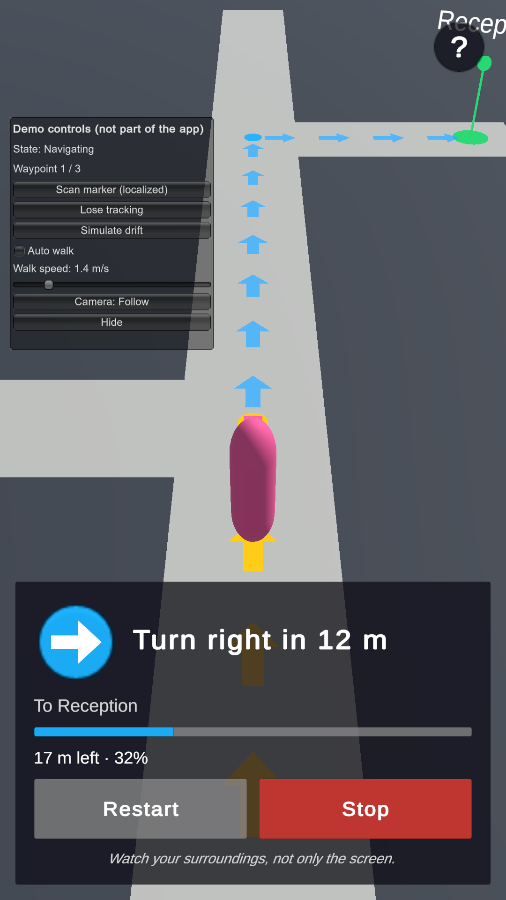
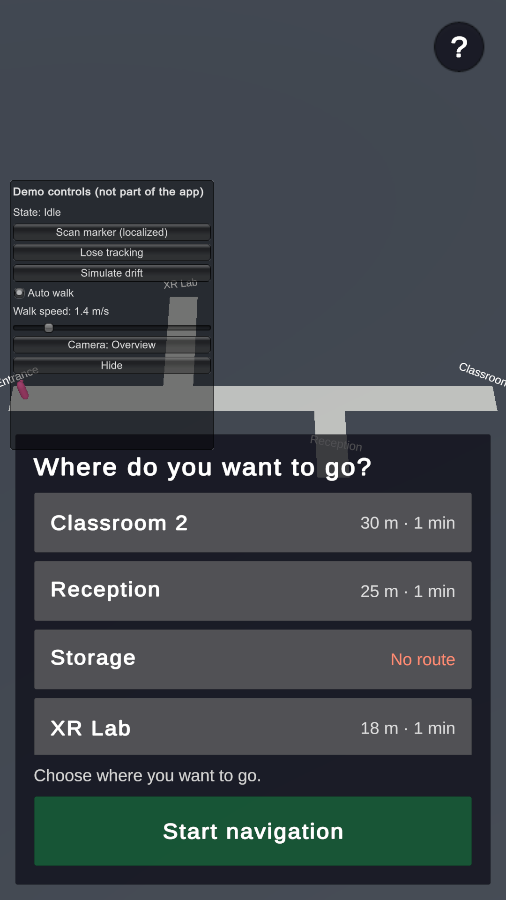
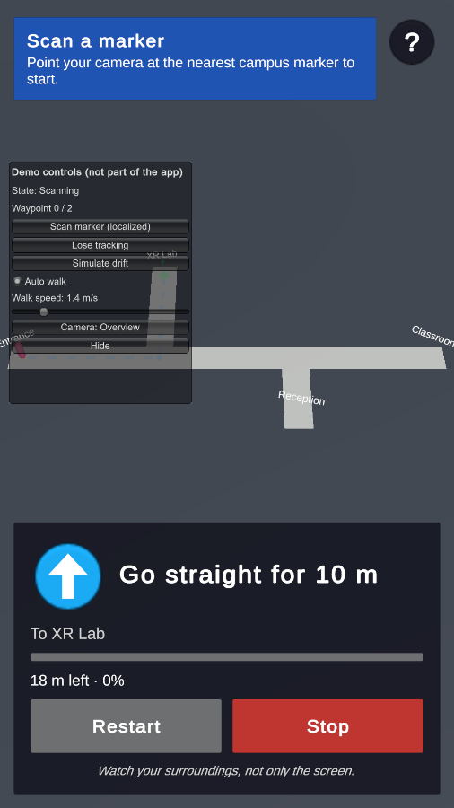
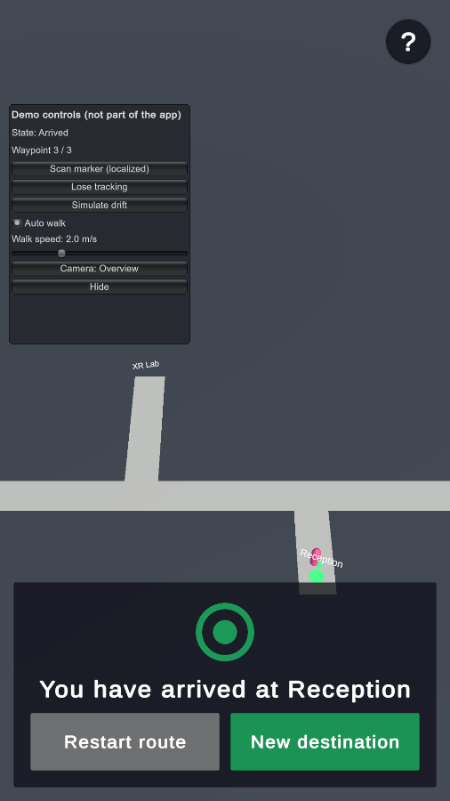
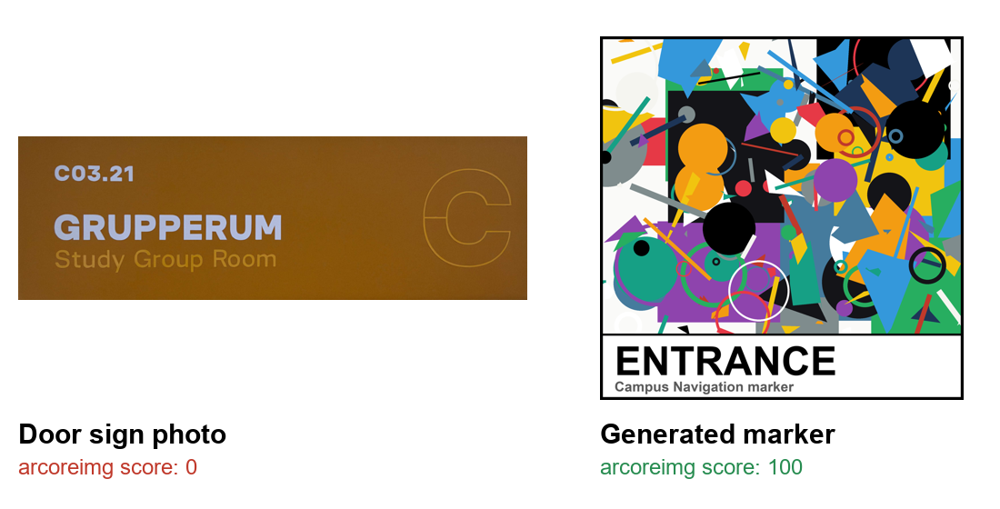

# DevBlog #2 – AR Guidance and User Interface

**Project:** AR Campus Navigation Assistant

## Introduction

The first post covered localization, which tells the app where the phone is in our campus coordinate system. This post covers **AR guidance and the user interface**: the floor arrows that show the route, the destination picker, turn instructions, progress, and the prompts that ask the user to rescan a marker when tracking becomes unreliable.

This module sits at the end of the pipeline, and the navigation engine that feeds it had not been built yet.

## Building Against Interfaces

The project proposal defined interfaces between the four modules. A small navigation contract (`INavigationService`) was written with the states from the proposal: *Idle, Scanning, Navigating, Relocalizing* and *Arrived*. A `MockNavigationService` implements it, so the UI could be developed in parallel, and the real engine can replace the mock later without changes to the guidance code.

All modules exchange positions in **campus coordinates** (meters). Only the renderer converts them to AR world space, through an alignment interface that wraps the localization module's `CoordinateMapper`. This keeps the arrows correct after a recalibration: when the alignment changes, the route is simply rebuilt.

## Floor Arrows in World Space

The route from pathfinding is a list of waypoints. The pathfinding module's `RouteSampler` places arrows about every 1.5 m, between the sample points, so an arrow never sits exactly on a corner where its direction would be ambiguous. Each arrow knows which waypoint it leads to, which makes highlighting simple:

```csharp
public static RouteVisualState StateFor(int index, int current)
{
    if (index < current) return RouteVisualState.Passed;   // hidden
    return index == current ? RouteVisualState.Next        // yellow, pulsing
                            : RouteVisualState.Upcoming;   // blue
}
```

The arrows are world-locked content: they stay at fixed physical positions while the user moves, which is the main difference from screen-space UI. That also makes them sensitive to tracking errors. When tracking is lost, the arrows fade instead of disappearing, so the user can see that the guidance is uncertain.



## The 2D Interface

The screen-space UI guides the user through the steps of the journey:

- **Destination selection** with distance and walking time, calculated from the user's current position. Unreachable rooms show "No route".
- **Navigation view** with the next turn ("Turn right in 12 m"), a progress bar, *Stop* and *Restart*.
- **Status banners** for "Scan a marker" and "Tracking lost", and an arrival screen.
- A **help screen** and a short reminder to watch the surroundings, because users of AR navigation tend to look only at the phone.

The UI targets portrait phones and respects the safe area around notches.




## Testing Without a Device

A demo scene runs the whole flow in the Unity editor. A simulated user walks the route, and a debug panel fakes device events: scanning a marker, losing tracking and alignment drift. Together with 44 EditMode tests for the mock navigation, arrow layout, renderer and UI texts, this made it possible to find bugs before testing in the hallway. For example, arrows stayed visible after arrival, and the instruction said "Go straight for 4 m" at a junction instead of naming the next real turn.



## Why the Markers Stopped Working

When the app was built for the phone with photos of real door signs as markers, it reported that the marker library contained no ARCore data. ARCore recognises images by detecting **feature points**: distinctive corners and textures that can be matched from different angles and distances. Google's `arcoreimg` tool rates images from 0 to 100 and recommends at least 75. The signs scored 0, because they are mostly one flat colour with a little text, and the two signs looked almost the same. The image database could not be built at all.

New markers were generated with many non-repeating shapes and strong contrast. Both score 100 and are printed at 18 cm, the size stored in the reference library, because ARCore uses the physical size to estimate distance. The updated screenshots in DevBlog #1 show these printed markers being detected on the phone.



## Reflection and Next Steps

Designing against interfaces and mocks allowed the guidance module to be finished before the rest of the pipeline existed, and the editor demo made testing fast. However, none of this proves the experience works in a real corridor. The next steps are to put the guidance into the AR scene with the real camera pose, test a complete route on the phone, run quick usability tests with other students, and record the video demonstration.
