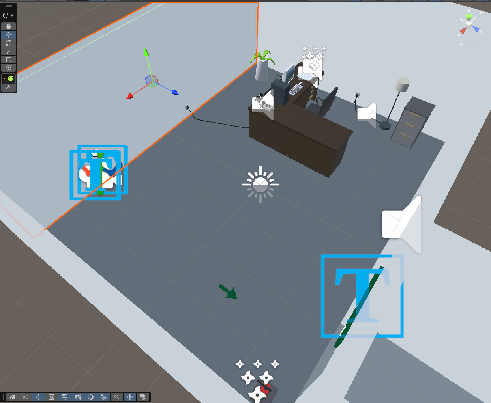
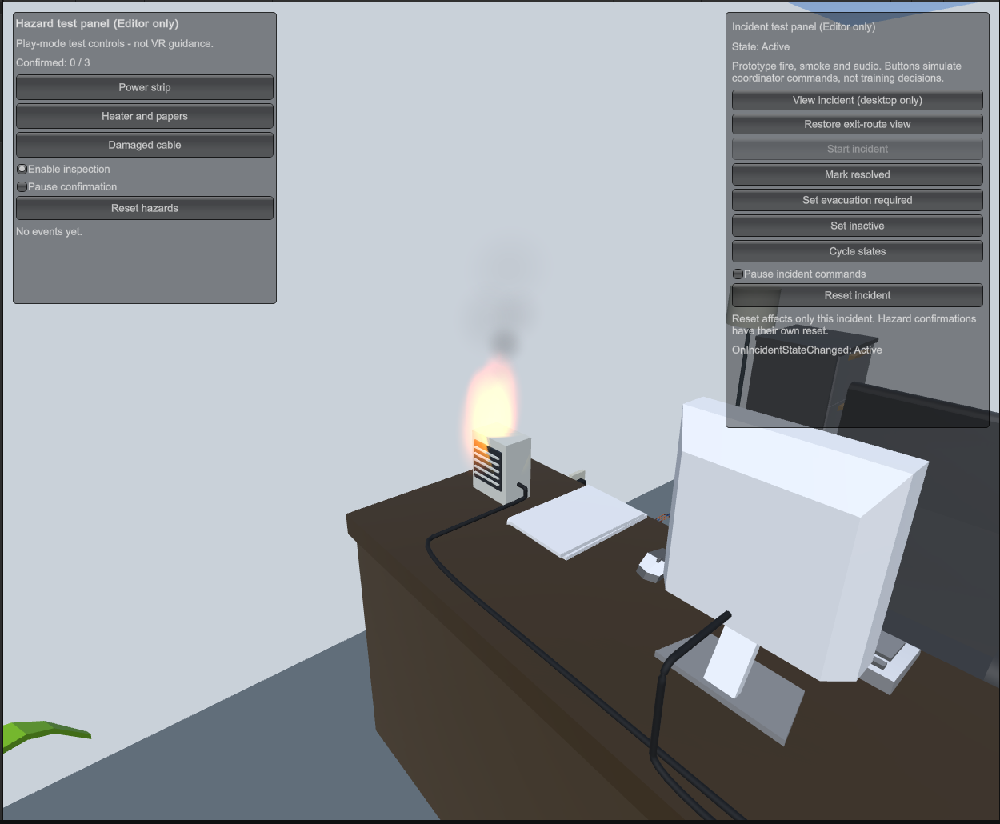
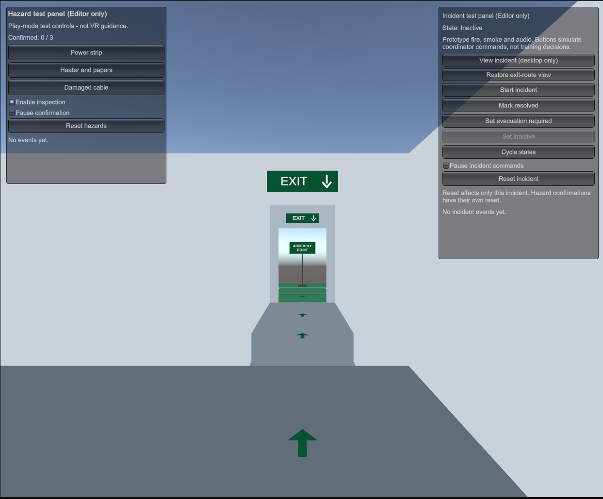

# DevBlog #1 – Building the VR Fire Safety Environment

**Project:** VR Fire Safety Training Simulator

## Introduction

The VR Fire Safety Training Simulator is a Unity project that places users in an office where they can identify potential hazards and respond to a simulated fire incident. The environment provides a space for exploring the scenario, following an exit route and reaching an assembly area.

This post focuses on the office environment, hazard feedback and incident presentation.

## Creating the Office

A compact office, corridor and assembly area were created for the scenario. The layout includes furniture, an exit route and signs to help users understand the space. Low-poly office assets were used to give the room a recognizable workplace appearance while keeping the environment suitable for a VR prototype.

[Insert a screenshot showing an overview of the office environment.]

The environment was first developed in the separate `OfficeBlockout` scene. This makes it possible to test the office and its systems independently before using them in the integrated `OfficeTraining` scene.

## Adding Hazards

Three inspectable objects were added to the office: a power strip, a heater with papers nearby, and a damaged cable. Each has a stable identifier so that other parts of the project can recognize which object was selected.

When a hazard is confirmed, it receives a green outline and plays a short sound. A registry tracks confirmed hazards and prevents the same object from being counted twice. The hazard system can also be paused and reset for a new session.

The objects are intended as prompts for the prototype, not as definitive safety advice. For example, the presence of a power strip alone does not establish that it is overloaded.

## Simulating the Incident

The incident system supports four states: inactive, active, resolved and evacuation required. These states are controlled by the scenario rather than by the environment deciding when a fire should start or end.

Simple flame and smoke particle effects were placed near the heater to represent the incident. Spatial fire and alarm sounds were added to make the event noticeable within the office. The effects are deliberately limited: they do not simulate fire spread, heat or realistic smoke movement. The alarm sound is a prototype, not an official alarm recording.

## Testing and Integration

The `OfficeBlockout` scene includes editor-only test panels for confirming hazards and changing incident states. These allow the visual feedback, audio, pause and reset behaviour to be checked without running the full training scenario. Automated editor tests also cover hazard confirmation and incident state behaviour.

The environment exposes events when a hazard is confirmed or the incident state changes. This allows the integrated scenario to respond without putting scoring or VR controller logic inside the environment systems.

## Next Steps

The environment and effects still need testing on the target headset, particularly for performance, audio and visual clarity. Safety content and signage also need review against appropriate local guidance before being used as factual instruction.

This project is a prototype, not a certified fire safety training product.
